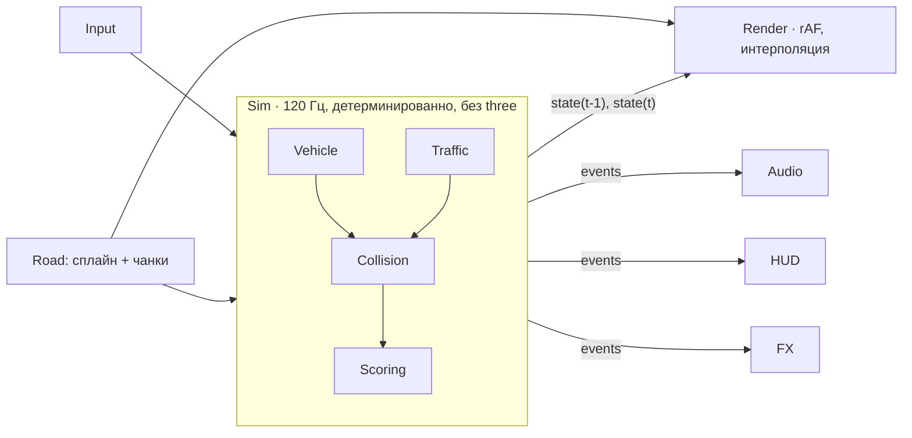

# Traffic Cutting Up — план разработки

> **Исторический план; частично выполнен и частично заменён.** Ниже сохранён первоначальный замысел, включая прежние оценки, бюджеты, стек меню, состав машин и «следующий шаг». Это не описание текущей сборки и не новые задания на реализацию. Актуальные запуск и управление — в [README.md](README.md), интеграция — в [docs/mobile-miami-upgrade.md](docs/mobile-miami-upgrade.md).
>
> Сейчас есть независимые Highway/Miami, онлайн по умолчанию (50 мест, настройка 1–64), серверные рекорды, DOM-меню, четыре кузова (A45, C63, Porsche, R34), телефонные кнопки, fullscreen/fallback и админка с вкладками. Miami — собственная геометрия 12 км из четырёх четвертей и ночная тема. Звук сочетает синтез с банками Porsche/M156; R34 использует порт TMeasy/Sketchbook. Low-пресета, гарантии загрузки до 5 МБ и подтверждённых 60 FPS на встроенной графике этот план не доказывает.
>
> После разрешённой правки только трёх коэффициентов R34 (1.22 / 1.07 / 1.10) вся физика заморожена; исторические предложения по физике ниже не разрешают её менять. Деплой на VPS, прослушивание человеком и физический iOS не подтверждены этой локальной приёмкой.

Браузерный мини-симулятор ночного cut up по хайвею в духе серверов No Hesi: скорость, плотный трафик, проезды впритирку и комбо, которое сгорает от первого удара.

---

## 0. Коротко

- **Жанр.** Аркадный симулятор: настоящее руление с рысканием и заносом, но физика прощает ошибки. Заезд бесконечный, очки начисляются за опасные проезды.
- **Стек.** Vite, TypeScript, Three.js (WebGL2), `postprocessing` от pmndrs, своя физика, Web Audio. Готовые игровые движки и физические библиотеки не нужны.
- **Главное архитектурное решение.** Дорога задаётся профилем кривизны, и трафик, коллизии и очки считаются в координатах дороги `(s, d)`. Это дёшево, а пологие повороты получаются без дополнительной работы.
- **Дорога — настоящий хайвей.** Длинные прямые и пологие дуги радиусом от 1200 м с плавными переходами (клотоидами). Резких поворотов нет.
- **В одиночном режиме трафик генерирует клиент**, случайно в каждом заезде. Реплеев и призраков нет. **Онлайн-режим** — общий мир на сервере: кольцо 12 км, общий трафик, до 5 водителей, прогноз и сверка на клиенте ([docs/online.md](docs/online.md)).
- **Визуал.** Ночь, натриевые и LED-фонари, блум, LUT. Вместо реальных источников света рисуются световые пятна, окна города генерирует шейдер.
- **Бюджет.** 60 FPS на встроенной графике в 1080p на пресете Medium, не больше 150 draw calls, стартовая загрузка до 5 МБ.

---

## 1. Разбор референса (swimco.kr ARCADE)

### Техника

| Что | Как сделано |
|---|---|
| Движок | Three.js **r128** (2021), грузится с одного из 4 CDN по очереди |
| Код | Один инлайн-скрипт примерно на **145 КБ**: мир, трафик, физика, звук, пост-обработка и UI в одном месте |
| Модели | GLB (`KHR_mesh_quantization`) в **base64 внутри 28 JS-файлов**, разбирает их собственный парсер GLB |
| Рендер | ACES, `FogExp2`, hemisphere + ambient + directional («луна») с тенью 2048 |
| Блум | Собственный: bright pass и blur; если не работает, отключается сам |
| Звук двигателя | Сэмплы на нескольких оборотах, переход между ними — равномощный кроссфейд |
| Слабые устройства | Режим `LOW` (тач или ≤ 4 ядер): без AA и теней, DPR не выше 1.75 |

### Геймплей

- **Игрок вперёд не едет**: мир сам движется к камере. Повторяющиеся группы объектов сдвигаются по модулю пройденного пути, трафик появляется на −470 м и удаляется после +52 м. Дорога прямая: 4 полосы по 3.8 м плюс обочины.
- **Управление только боковое** (`x`, `vx`), рыскания и заноса нет. Газ автоматический, S — тормоз, Space — NOS.
- **Очки:**
  - `CLOSE CALL` = (70 + близость·260) × множитель × 1.5 за грузовик × 1.6 под NOS;
  - `WHITELINE` (проезд между двумя машинами) даёт ×2.4;
  - комбо до 24, множитель равен 1 + 0.5·комбо (максимум 13), таймер комбо 3.4 с;
  - near miss заряжает NOS.
- **Трафик.** 8 типов машин с весами, грузовики ездят только в правых полосах. Каждые 5–13 с меняется «режим трафика»: `normal`, `sparse`, `trucks` или `wall` (три машины в ряд, свободна одна полоса). Часть водителей подрезает. Есть два уровня сложности, easy смягчает спавн и хитбоксы.
- **Свет.** Небольшой пул реальных точечных источников переставляется на ближайшие к игроку фонари, остальные фонари — emissive с бликом. Тени машин — blob-текстура.
- Скорость на спидометре замаскирована: 155 км/ч показываются как «x55».

### Что взять
Скроллинг мира с переиспользованием объектов, blob-тени, пул ламп, режимы трафика (особенно `wall`), бонус за проезд между машинами и за грузовики, заряд буста от near miss, пауза при скрытии вкладки, трафик на дороге сразу при старте, автоопределение слабого устройства.

### Что сделать лучше
| Референс | У нас |
|---|---|
| Монолитный скрипт | Модули на TypeScript, симуляция отделена от рендера |
| three r128 | Актуальная версия three |
| base64-GLB внутри JS (+33 % к весу, разбор в основном потоке) | Бинарные GLB с meshopt и KTX2, декодирование в воркере, кэширование по HTTP |
| Только боковое смещение | Bicycle model: руль, рыскание, занос, передачи |
| Прямая дорога | Сплайн с поворотами, тоннели, развязки |
| `clone()` на каждую машину | `InstancedMesh` на каждый тип машины |
| Шаг симуляции зависит от FPS | Фиксированный шаг 120 Гц: физика ведёт себя одинаково при 30 и 240 FPS |

---

## 2. Геймдизайн

### Основной цикл
Едешь по хайвею → разгоняешься → проезжаешь впритирку к машинам → растёт комбо и счёт заезда → удар обнуляет заезд, лучший результат сохраняется → новый заезд начинается сразу, без меню, прямо на ходу (как на серверах No Hesi).

### Очки (стартовые значения, дальше тюнинг)
- **Дистанция** приносит очки только выше порога скорости (~120 км/ч), чем быстрее, тем больше.
- **Near miss**: боковой зазор < 1.0 м при относительной скорости > 30 км/ч. Очки = `base(зазор) × f(отн. скорость) × множитель`.
- **Lane split**: проезд между двумя машинами в соседних полосах, крупный бонус.
- **Обгон** без near miss: мало очков, но комбо продлевается.
- **Множитель** растёт от комбо и от скорости. Таймер комбо 3–4 с, ниже порога скорости он идёт вдвое быстрее.
- **Риск/награда — весь заезд.** Отдельного банка у комбо нет: под угрозой весь счёт заезда. Столкновение с машиной заканчивает заезд, счёт сравнивается с рекордом и обнуляется. Так проще и ближе к No Hesi.
- **Штрафы.** Касание стены сбрасывает комбо и множитель, но не заезд. Пока едешь по обочине, комбо не растёт.
- **Slipstream.** В 5–25 м за машиной падает сопротивление воздуха и заряжается буст. Это ближе к симу, чем NOS; сам NOS можно оставить в аркадном режиме.

### Режимы
1. **Cut Up** — бесконечная езда, заезд обнуляется при ударе.
2. **Time Attack** — 3 минуты на максимальный счёт.
3. **Cruise** — без очков, просто покататься.

Трафик в каждом заезде случайный и генерируется на клиенте. Рекорды хранятся локально (`localStorage`). Онлайн-таблицу можно добавить позже, но без детерминированной симуляции защитить её от накрутки можно только грубыми проверками правдоподобия.

### Машины
Три вымышленные машины без брендов: лёгкое JDM-купе (вёрткое), немецкий седан (стабильный), суперкар (быстрый и нервный).

### Управление
- Клавиатура: A/D — руль с плавным нарастанием, W/S — газ и тормоз, Shift — буст, C — смена камеры.
- Геймпад через Gamepad API: аналоговый руль, триггеры.
- Тач: кнопки или наклон устройства.

---

## 3. Стек

| Слой | Выбор | Почему |
|---|---|---|
| Сборка | **Vite + TypeScript (strict)** | Мгновенный HMR, разбиение кода, обработка ассетов |
| Рендер | **three (последняя) + `WebGLRenderer` (WebGL2)** | Работает везде. WebGPU здесь не нужен: упираемся в fill-rate и пост-обработку, а не в накладные расходы API |
| Пост-обработка | **`postprocessing` (pmndrs)** | Собирает эффекты в 1–2 полноэкранных прохода; есть mipmap-блум, SMAA, LUT |
| Физика | **Своя** (bicycle model + IDM/MOBIL) | Rigid-body движок для хайвея не нужен. Своя физика даёт полный контроль над ощущением и детерминизм |
| Аудио | **Web Audio API** напрямую | Кроссфейд по оборотам, фильтры, `PannerNode` для пролётов |
| UI | HUD — DOM + CSS с прямой записью значений; меню — **Preact + signals** | Фреймворк не перерисовывает HUD каждый кадр |
| Ассеты | **glTF/GLB + meshopt + KTX2** через `gltf-transform` CLI | Быстрое декодирование в воркере, мало видеопамяти |
| 3D-контент | Blender; CC0 (Kenney, Quaternius, Poly Haven) | Только свой или свободный контент, никаких машин из модов AC |
| Инструменты | Tweakpane, stats-gl, Spector.js, Vitest, ESLint + Prettier | Тюнинг физики на лету, профилирование GPU, тесты |
| Хостинг | **Cloudflare Pages** (или любой статический хостинг) | Статика на CDN, brotli, бесплатно; сервер не нужен |

---

## 4. Архитектура

```
src/
  core/      loop.ts (фикс. шаг), rng.ts (seeded), input.ts, events.ts, config.ts
  sim/       vehicle.ts, tires.ts, drivetrain.ts, traffic.ts (IDM/MOBIL),
             director.ts (плотность/режимы), collision.ts (SAT), scoring.ts
  world/     road/spline.ts, road/chunks.ts, road/mesh.ts,
             props/ (инстансы), city.ts, sky.ts, tunnel.ts
  render/    renderer.ts, post.ts, camera.ts, quality.ts, materials/, fx/ (частицы, light pools)
  audio/     engine.ts, sfx.ts, mixer.ts
  ui/        hud.ts, menus/ (Preact)
  assets/    loader.ts (GLTF + meshopt + KTX2), manifest.ts
```



### Принципы
- **Симуляция отдельно от рендера.** Sim — чистый TypeScript без three, с фиксированным шагом 120 Гц. Её можно покрыть тестами, а физика ведёт себя одинаково при любом FPS. Рендер интерполирует между двумя последними состояниями. Детерминизм не нужен: трафик случайный, реплеев нет. RNG передаётся параметром только чтобы в тестах воспроизводить ситуации.
- **Дорога как профиль кривизны.** Генератор выдаёт кусочно-линейную кривизну κ(s): прямая 400–1500 м → переход 150–300 м → дуга R = 1200–3000 м → переход → прямая. Из κ интегрируется таблица с шагом 2 м: позиция, направление, кривизна. Максимальная кривизна 1/1200 даёт ~5 м/с² бокового ускорения на 290 км/ч, то есть поворот проходится в газ. Позже можно добавить пологие подъёмы.
- **Всё считается в координатах дороги.** Машина трафика хранит только `(s, смещение полосы, v)`, её мировая позиция берётся из таблицы. Игрок тоже симулируется во френеевых координатах `(s, d, ψ)`: `ṡ = v∥ / (1 − κd)`, `ḋ = v⊥`, `ψ̇ = r − κṡ`. Проецировать машину на дорогу не нужно.
- **Коллизии и near miss в локальной системе дороги.** Кандидаты — машины с |Δs| < 15 м (трафик в каждой полосе отсортирован по `s`), проверка — SAT для двух OBB в 2D. Near miss срабатывает, когда у машины меняется знак Δs, а боковой зазор меньше порога. Стены — ограничение по `|d|`.
- **Floating origin.** Каждые ~2 км мир сдвигается обратно к нулю, чтобы float32 на GPU не дрожал.
- **Чанки по 200 м.** В чанке геометрия дороги и пропсы, всё генерируется детерминированно из `seed + index`. Кольцевой пул из ~8 чанков: один позади, 6–7 впереди.
- **Шина событий.** Sim отправляет `nearMiss`, `laneSplit`, `crash`, `wallHit`, `runEnd`, на них подписаны звук, HUD и эффекты. Sim про них ничего не знает.

---

## 5. Физика и трафик

### Машина игрока
- **Bicycle model** (две оси). Боковая сила шины `Fy = D·sin(C·atan(B·α))` — упрощённая «магическая формула» с насыщением. Занос и контрруление возможны, но предсказуемы.
- **Продольная динамика.** Кривая момента × передаточные числа → тяга. Аэродинамика `½ρ·Cd·A·v²`, сопротивление качению, тормоза с упрощённым ABS.
- **Коробка.** По умолчанию автомат, ручная — опция. Обороты, отсечка, переключение за 0.15 с с провалом тяги и звуком.
- **Руль зависит от скорости.** Это главное, чтобы на клавиатуре было приятно. Максимальный угол падает с ~30° на месте до 3–4° на 250 км/ч. Нажатие нарастает плавно, отпускание возвращает руль к центру.
- **Ассисты (слайдер):** стабилизация рыскания, автоконтрруление, трэкшн-контроль.
- **Визуальная подвеска.** Крен, тангаж и подпрыгивание считаются от ускорений через пружину с демпфером и влияют только на картинку.

### Трафик
- **IDM** (Intelligent Driver Model) — следование за машиной впереди. **MOBIL** — решение о смене полосы.
- **Поворотники** включаются за 1–1.5 с до манёвра, чтобы игроку было честно. Небольшая доля «грубых» водителей с агрессивными параметрами.
- **Директор трафика** управляет плотностью и режимами (`sparse`, `trucks`, `wall`, `convoy`) и повышает сложность со временем. Новые машины появляются только вне видимости (за поворотом или в тумане), рядом с игроком действует лимит на их число.
- **Авария.** Импульс в 2D плюс скриптовая анимация: вращение, искры, slow-mo 0.3 с, отдельная камера. Rigid-body физики нет.

---

## 6. Визуал

**Направление:** ночной городской хайвей, придуманный нами: эстакада с поворотами, тоннели, шумозащитные стены, развязки, город за ограждением.

### Свет и атмосфера
- **Небо.** Градиентный шейдер, засветка у горизонта, звёзды, луна-спрайт. Туман цвета горизонта прячет дальнюю плоскость и спавн.
- **Фонари** меняются по участкам: старые натриевые (оранжевые) и новые LED (холодные). Это меняет настроение без затрат.
- **Почти без реальных источников света.** Под фонарями лежат инстансированные additive-декали световых пятен, сама лампа — emissive с бликом, остальное дорисовывает блум. Реальных источников всего несколько:
  - луна (directional);
  - фары игрока (1 SpotLight с текстурой-маской);
  - пул из 4 point light, которые переставляются на ближайшие фонари и подсвечивают кузов игрока (идея из референса).
- **Тоннели.** Ряды ламп на потолке дают ритмичные блики на кузове. Самый эффектный и самый дешёвый участок.
- **Асфальт.** Тайловая текстура, normal и roughness с укатанными колеями. В режиме «мокро» (Ultra или погода) roughness ниже, отражения огней — вытянутые зеркальные billboards, из-под колёс летят брызги.

### Машины и город
- **Краска** — `MeshPhysicalMaterial` с clearcoat. Карта окружения — PMREM ночного города, рендерится один раз.
- **Огни трафика** — emissive. Стоп-сигналы ярче при торможении (instance-атрибут), поворотники мигают.
- **Ночью издалека видны только огни.** Дальше ~150 м машину можно рисовать двумя парами светящихся спрайтов: и выглядит правильно, и почти бесплатно.
- **Город** — инстансированные коробки, окна генерирует шейдер по `hash(instanceId)`, текстуры не нужны. Дальний план — цилиндр с панорамой (impostor).

### Пост-обработка (один merged-проход)
- Блум (mipmap, порог ~1.0 в HDR).
- Тональная компрессия AgX или ACES.
- LUT-грейдинг: бирюзовые тени, тёплые света.
- Виньетка, лёгкое зерно.
- Хроматическая аберрация и радиальный блюр только на высокой скорости и бусте.

### Ощущение скорости
- FOV 60° → 78° с ростом скорости, камера на пружине с отставанием, лёгкая тряска выше 200 км/ч, линии скорости.
- Near miss: короткий толчок камеры, свист проезжающей машины, хроматическая аберрация на 100 мс.
- Частицы из одного пула GPU-points: искры от стены, хлопки выхлопа на отсечке, пыль на обочине.

### HUD
- Минимализм, цифры с `tabular-nums`, шрифт Chakra Petch или Rajdhani.
- Сверху по центру — счёт, множитель и кольцо таймера комбо.
- Попапы «NEAR MISS +1 240» влетают в счёт.
- Снизу справа — дуга спидометра с тахометром и передачей.
- Один акцентный цвет (например, кислотно-салатовый).
- Камеры: chase, близкая chase, капот, бампер.

---

## 7. Оптимизация

### Бюджеты по пресетам

| | Low | Medium | High |
|---|---|---|---|
| Цель | 30–60 FPS, телефон | 60 FPS, встроенная графика 1080p | 120+ FPS, дискретная |
| Draw calls | ≤ 80 | ≤ 150 | ≤ 250 |
| Треугольники в кадре | 300k | 800k | 2M |
| Масштаб рендера / DPR | 1.0 | 1.0–1.25 | до 2.0 |
| Тени | blob | blob + 1024 у игрока | blob + 2048 |
| Блум | 1/4 разрешения | 1/2 | 1/2, больше мипов |
| Сглаживание | нет / FXAA | SMAA | SMAA или MSAA 4× |
| JS на кадр | ≤ 3 мс | ≤ 3 мс | ≤ 3 мс |

### Приёмы
1. **Инстансинг всего, что повторяется:** фонари, отбойники, стойки, знаки, деревья — по `InstancedMesh` на тип; здания — `BatchedMesh`.
2. **Трафик на инстансах.** На каждый тип машины свой `InstancedMesh`, колёса отдельным инстансом, цвет через `instanceColor`, стоп-сигналы через атрибут. 40 машин дают 15–25 draw calls вместо 400+.
3. **Склейка статики в чанке** по материалам (`mergeGeometries`): 2–4 draw calls на чанк, frustum culling по bounding sphere всего чанка.
4. **Материалы и текстуры.** Минимум уникальных материалов, атласы, KTX2 (ETC1S для альбедо окружения, UASTC для нормалей), мипмапы.
5. **LOD машин.** Три уровня, дальний — только огни (см. раздел 6).
6. **Ноль аллокаций в игровом цикле.** Пулы объектов, заранее созданные `Vector3`/`Matrix4`, никаких замыканий в горячем коде.
7. **Фиксированный шаг** симуляции с интерполяцией. `dt` ограничен 0.1 с, при `visibilitychange` игра встаёт на паузу.
8. **Динамическое разрешение.** По скользящему среднему времени кадра масштаб рендера меняется в пределах 0.6–1.0. Пресет выбирается автоматически при первом запуске: двухсекундный бенчмарк в меню плюс эвристика по GPU.
9. **Прогрев шейдеров.** `renderer.compileAsync(scene, camera)` под экраном загрузки для всех вариантов материалов, включая все типы трафика. Иначе при первом появлении грузовика игра подвиснет.
10. **Загрузка.**
    - Критический путь (дорога, машина игрока, звук двигателя) — не больше 5 МБ, остальное догружается, пока игрок в меню.
    - Декодеры meshopt и KTX2 работают в воркерах.
    - На хостинге brotli, имена файлов с хэшем, вечный кэш.
11. **Аудио.** `decodeAudioData` заранее, ограничение на число одновременных голосов, `AudioContext.resume()` по первому клику.
12. **Профилирование.** stats-gl (время на GPU), `renderer.info`, Spector.js, вкладка Performance в Chrome. Регулярно проверять на слабом ноутбуке, а не только на рабочей машине.

---

## 8. Дорожная карта

| # | Фаза | Результат | Критерий готовности | Оценка |
|---|---|---|---|---|
| 0 | Каркас | Vite + TS + three, линтеры, Tweakpane, stats, деплой на CF Pages | Пустая сцена открывается по ссылке | 1–2 дня |
| 1 | **Серый прототип** | Бесконечная дорога с пологими дугами и чанками, floating origin, машина-коробка на bicycle model, chase-камера, кубы-трафик с IDM и сменой полос, коллизии, near miss, очки и HUD, панель тюнинга | **Играть в кубы уже весело.** Здесь же настраивается руль | 1–1.5 нед |
| 2 | Мир | Разметка и обочины начисто, инстансированные пропсы, стены, тоннели, эстакады, смена участков | 10 минут езды без швов и дрожания, дорога не надоедает | 1.5 нед |
| 3 | Трафик | MOBIL, поворотники, грузовики, директор, режимы | Трафик выглядит живым, нечестных аварий нет | 1 нед |
| 4 | Очки и HUD | Комбо и банк, множители, попапы, спидометр, итоги, локальный рекорд | Полный игровой цикл | 1 нед |
| 5 | Визуал | Модели машин, материалы, световые пятна, блум, LUT, небо, город, частицы, камеры | Скриншот хочется выложить | 2 нед |
| 6 | Звук | Двигатель по оборотам, турбина, ветер, шины, свист проезда, UI | Можно играть с закрытыми глазами (почти) | 1 нед |
| 7 | Оптимизация | Бюджеты, динамическое разрешение, пресеты, мобильное управление | Medium держит 60 FPS на встроенной графике | 1 нед |
| 8 | Мета | Меню, выбор машины, режимы, локальные рекорды, настройки | Всё работает без сервера | 1 нед |
| 9 | Полировка и релиз | Онбординг, настройки, баги | — | 1 нед |

**MVP** (фазы 0–4 и черновой визуал) — около 4 недель. **Полная версия** — 2.5–3 месяца на одного разработчика при полной занятости.

---

## 9. Риски

| Риск | Что делаем |
|---|---|
| На клавиатуре на 250 км/ч руль дёрганый | Угол руля зависит от скорости, ввод нарастает плавно; настраиваем в фазе 1 до того, как браться за визуал |
| Фризы при компиляции шейдеров | `compileAsync` на экране загрузки |
| Права на контент | Не берём машины из модов AC и из референса, не используем бренды и названия Assetto Corsa / No Hesi |
| Safari и iOS | Звук только после жеста пользователя, следим за видеопамятью, Low-пресет по умолчанию на мобильных |
| Однообразие прямой дороги | Пологие дуги, смена участков (натрий/LED, тоннели, эстакады), режимы трафика |

---

## 10. Следующий шаг
Фазы 0 и 1: каркас проекта и серый прототип на кубах. Ставим цель найти «то самое» ощущение руля и проездов впритирку, пока нет ни одной модели.
