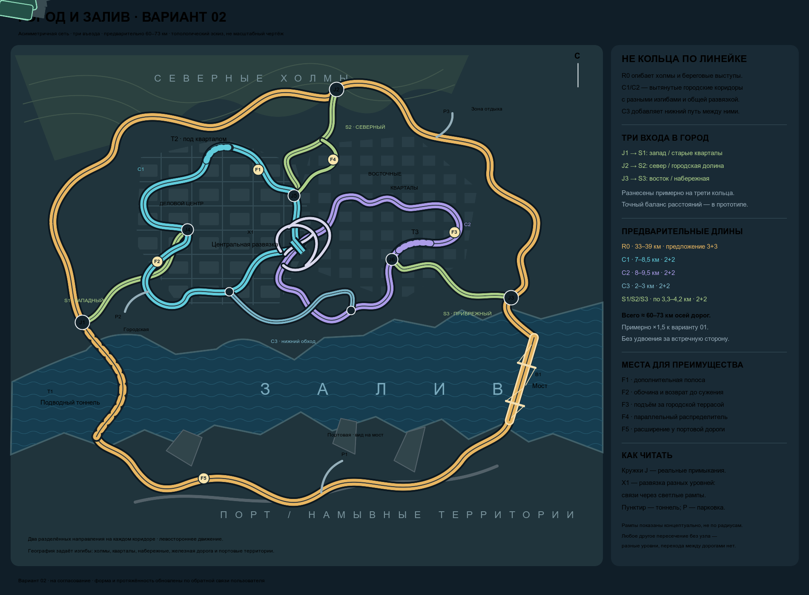

# «Город и залив» — вариант 02

Статус: новая компоновка на согласование по этапу 1 [спецификации](../map_spec.md). Заменяет слишком регулярную схему 01.

[Редактируемая SVG-схема](map-layout.svg).

## 1. Изменения по обратной связи

- Убраны прямоугольное внешнее кольцо и аккуратные овальные городские петли.
- Внешний маршрут имеет асимметричные изгибы: он огибает холмы, существующие кварталы, береговые выступы и портовую железную дорогу.
- Городские маршруты вытянуты и неоднородны: отдельные почти прямые участки сменяются смещениями вдоль кварталов, подходами к тоннелям и эстакадными связками.
- Деловой центр и восточные кварталы непосредственно связаны большой многоуровневой развязкой X1. Прежнее короткое отдельное соединение S3 упразднено: теперь S3 — третий вход с кольца.
- Дополнительный нижний городской обход C3 позволяет объезжать X1 и составлять смешанные маршруты.
- В город ведут **три длинных входа** с западного, северного и восточного участков R0. Их ориентир — примерно трети длины кольца, а не три соседних съезда. Точные длины дуг нужно уравновесить на геометрическом прототипе.
- Общая протяжённость увеличена приблизительно в полтора раза: с 40–48,5 км до 59,9–72,6 км осей, округлённо **60–73 км**.

Реалистичность здесь означает привязку формы к препятствиям и структуре города, а не случайную извилистость. Прямые, плавные дуги и достаточные расстояния между съездами остаются необходимыми. Изгибы SVG не задают фактические радиусы.

## 2. География

Север сверху. Неровный северный берег занят городом, южный — намывными портовыми территориями. На северной окраине холмы, на юге портовая железная дорога. Залив пересекается двумя разными частями одного замкнутого внешнего маршрута:

- **T1 на западе:** подводный тоннель с косым проходом под заливом; порталы находятся на суше, вне J1.
- **B1 на востоке:** диагональный большой мост, начинающийся после сухопутной развязки J3.

Северный берег не прямой: небольшие бухты и выступы определяют форму прибрежного подхода S3 и нижних городских участков.

## 3. Маршруты и размеры

| ID | Участок | Предварительная длина | Полосы | Характер |
| --- | --- | --- | --- | --- |
| R0 | Внешнее кольцо | 33–39 км | Предложение 3+3 | Холмы, периферия, неровный берег, мост, порт, подводный тоннель |
| C1 | Деловой центр | 7–8,5 км | 2+2 | Смещённые эстакадные коридоры между кварталами, вытянутый южный возврат, короткий тоннель |
| C2 | Восточные кварталы | 8–9,5 км | 2+2 | Неравномерная застройка, городская терраса, прибрежные изгибы |
| C3 | Нижний городской обход | 2–3 км | 2+2 | Альтернатива проезду через X1, связывает южные части C1 и C2 |
| S1 | Западный вход | 3,3–4,2 км | 2+2 | От J1 над старыми кварталами к западному краю центра |
| S2 | Северный вход | 3,3–4,2 км | 2+2 | От J2 вдоль долины застройки к северо-восточному краю центра |
| S3 | Восточный вход | 3,3–4,2 км | 2+2 | От J3 вдоль неровной набережной к восточным кварталам |

Длины — сумма уникальных осей, без удвоения за встречное направление. Рампы X1 и других развязок, местный распределитель F4 и парковочные подъезды пока отдельно не посчитаны. Средние оценки: вариант 01 — 44,25 км; вариант 02 — 66,25 км, отношение **1,497**. Под «в полтора раза больше» здесь понимается протяжённость, не одновременно длина, ширина и площадь.

Предварительные ориентиры внутри указанных длин:

- B1 с подходами: 2,3–3 км, входит в R0;
- T1 с уклонными подходами: 3,8–5,2 км, входит в R0;
- T2 под кварталом C1 и T3 под городской террасой C2: ориентировочно по 450–900 м, входят в длины C1/C2.

При средней скорости 160 км/ч круг R0 занимает около **12,4–14,6 мин**, при 120 км/ч — **16,5–19,5 мин**. Это арифметические примеры, не целевые скорости. Темп проверяется на существующей физике автомобилей.

## 4. Узлы и связность

| Узел | Связи | Принцип |
| --- | --- | --- |
| J1 | R0 ↔ S1 | Западный вход, на суше перед подходом к подводному тоннелю |
| J2 | R0 ↔ S2 | Северный вход, между холмами и городской застройкой |
| J3 | R0 ↔ S3 | Восточный вход, на суше до подхода к мосту |
| J4 | S1 ↔ C1 | Западная часть центра |
| J5 | S2 ↔ C1 | Северо-восточная часть центра, параллельный распределитель F4 |
| J6 | S3 ↔ C2 | Восточная часть кварталов |
| X1 | C1 ↔ C2 | Прямая многоуровневая городская развязка с направленными скоростными рампами |
| Концы C3 | C1 ↔ C3 ↔ C2 | Два локальных узла, отдельная альтернатива X1 |

J1–J6 должны поддерживать вход/выход в обоих направлениях соответствующих коридоров. X1 сохраняет непрерывный проезд по C1 и C2, а переход между ними выполняется только по рампам, а не в точке пересечения. Светлые линии X1 на рисунке передают замысел направленных веток; это не готовая матрица манёвров и не геометрия для строительства.

На детальной раскладке X1 нужно задать все необходимые переходы между направлениями C1/C2, отметки высот, длины слияний и отсутствие конфликтов. Нельзя превратить декоративный завиток на схеме в непроезжаемую медленную рампу: сохраняется требование скоростной езды с умеренным торможением.

Любое пересечение без символа узла не создаёт дополнительного соединения. В частности, нижний обход и рампы X1 могут проходить под/над соседними коридорами, не соединяясь с ними.

Примеры поездок:

1. **Внешний круиз:** P1 → портовая часть R0 → B1 → J3 → северная периферия → J2 → западная периферия → J1 → T1 → P1.
2. **Из порта в центр:** P1 → T1 → J1 → S1 → J4 → C1 → P2.
3. **Из порта в восточные кварталы:** P1 → B1 → J3 → S3 → J6 → C2.
4. **Через весь город:** J1 → S1 → C1 → X1 → C2 → S3 → J3 → R0.
5. **Нижний обход:** C1 → C3 → C2 вместо X1; полезность зависит от потока и выбранной точки назначения.
6. **Северный подход:** J2 → S2 → J5 → C1, затем X1 или C3 для перехода на C2.

Все три входа ведут в общую связанную городскую сеть. Тупиковых скоростных ответвлений нет. C1 и C2 остаются замкнутыми маршрутами, но визуально и пространственно не должны восприниматься правильными кольцами.

## 5. Парковки

| ID | Положение | Подключение |
| --- | --- | --- |
| P1 | Портовый берег, вид на мост и залив | Южная часть R0 |
| P2 | Южно-западная часть делового центра | C1 |
| P3 | Северо-восточная периферия, зона отдыха | R0 между северным и восточным входами |

Выбор любой площадки при входе, R и возврат после аварии — на выбранную площадку. Подъездные линии условны. Детальная планировка должна обеспечить доступ и выезд в оба направления через рампы, без пересечения встречного потока. Парковки не заменяют один из трёх городских входов.

## 6. Места для преимущества

- **F1:** короткая дополнительная полоса на подходе из северной части C1 к центру.
- **F2:** широкая обочина на западной городской эстакаде с читаемым возвратом перед сужением.
- **F3:** подъём у городской террасы на востоке C2; полезно заранее выбрать позицию.
- **F4:** параллельный распределитель на S2 перед J5; выбор между основным ходом и боковой веткой.
- **F5:** расширение вдоль портовой дороги, заканчивающееся видимым ограждением.

Конкретное направление и длины этих мест уточняются с поперечными профилями. Обзор должен позволять реакцию на трафик; знание карты помогает подготовиться, а не спасает от невидимых ловушек.

## 7. Следующие решения

Согласовать новый характер сети, расположение трёх входов и ориентир 60–73 км. Затем проработать X1 и один из внешних входов с реальными направлениями рамп, высотами и дистанциями. На этапе 2 проверить пространственный прототип прежде, чем фиксировать радиусы и итоговые длины.
